<div align="center">

<a href="https://m7neeb.github.io/courseify/">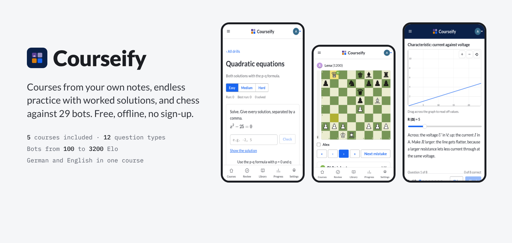</a>

<br />

**[Open Courseify](https://m7neeb.github.io/courseify/)** &nbsp;·&nbsp; [Features](#features) &nbsp;·&nbsp; [Screenshots](#a-closer-look) &nbsp;·&nbsp; [Courses included](#courses-included) &nbsp;·&nbsp; [Run it locally](#run-it-locally)

<br />

[](https://github.com/M7neeb/courseify/actions/workflows/deploy.yml)


[](LICENSE)

</div>

<br />

Courseify is a free study app that turns any topic, or your own handouts and notes, into a real
course: short lessons, plenty of practice, skills that level up from *Attempted* to *Mastered*, and a
review that brings back exactly what you got wrong. Everything runs in your browser, works offline
and stays on your device. No account, no subscription, no tracking.

<div align="center">

</div>

## Features

<table>
  <tr>
    <td width="50%" valign="top">
      <h3>Learn</h3>
      <ul>
        <li><b>Lessons in three depths:</b> normal, simple (for when you're lost) and detailed, with worked examples, key points and common mistakes.</li>
        <li><b>Formulas, diagrams and graphs.</b> Graphs come with sliders you drag to see what each value does.</li>
        <li><b>Tap a term</b> for its meaning, in German and English.</li>
        <li><b>German and English</b> in one course, switchable in every lesson.</li>
        <li><b>Code that runs</b> right in the lesson, in Python or JavaScript.</li>
      </ul>
    </td>
    <td width="50%" valign="top">
      <h3>Practise</h3>
      <ul>
        <li><b>Fifteen question types</b>, from multiple choice to written answers, tap-the-picture questions, trace tables, and programming, SQL and command-line tasks checked by the app.</li>
        <li><b>Drills:</b> endless new problems with a worked solution you open step by step, for IT (binary, hex, units, subnets, IPv6, packets and captures) and maths, plus a hash lab, a password check and a network plan builder.</li>
        <li><b>Mock exams:</b> a timed test over a whole course, graded at the end.</li>
        <li><b>Mistake review</b> brings back what you missed, spaced out so it sticks.</li>
      </ul>
    </td>
  </tr>
  <tr>
    <td width="50%" valign="top">
      <h3>Play chess</h3>
      <ul>
        <li><b>29 bots</b> from 100 to 3200 Elo, each with a style and favourite openings, or a custom bot at any strength.</li>
        <li><b>Clocks</b> from bullet to rapid, or no timer, with premoves.</li>
        <li><b>Draw on the board:</b> right-click for coloured squares and arrows.</li>
        <li><b>Game review</b> move by move: brilliant moves to blunders, the best move on the board, accuracy and the opening.</li>
        <li><b>Endgame drills</b>, a free board, board colours and sounds, and a bot rating.</li>
      </ul>
    </td>
    <td width="50%" valign="top">
      <h3>Track</h3>
      <ul>
        <li><b>Mastery for every skill</b> on a 0-100 scale, rolled up into units, courses and subjects.</li>
        <li><b>Exam date planner:</b> set a date and get a plan for learning and review time up to it.</li>
        <li><b>Weekly report and milestones</b>, streaks and a daily goal.</li>
      </ul>
    </td>
  </tr>
  <tr>
    <td width="50%" valign="top">
      <h3>Make your own</h3>
      <ul>
        <li><b>Course builder:</b> six short steps turn a topic and your own notes into a ready-to-paste brief. Paste the reply into <i>Import</i> and it becomes a course.</li>
        <li><b>Starting points</b> for exam prep, programming, IT and networks, maths, chess and more.</li>
        <li><b>Forgiving import</b> that lists anything broken with a fix-it prompt; report a wrong question and fix it the same way.</li>
      </ul>
    </td>
    <td width="50%" valign="top">
      <h3>Yours</h3>
      <ul>
        <li><b>Works offline</b> and installs on your phone's home screen.</li>
        <li><b>Private by design:</b> no server, no analytics. Backups are one click.</li>
        <li><b>Share a course</b> as a single file.</li>
        <li><b>Ten colour themes</b> with light and dark modes.</li>
      </ul>
    </td>
  </tr>
</table>

## A closer look

<table>
  <tr>
    <td width="50%" valign="top">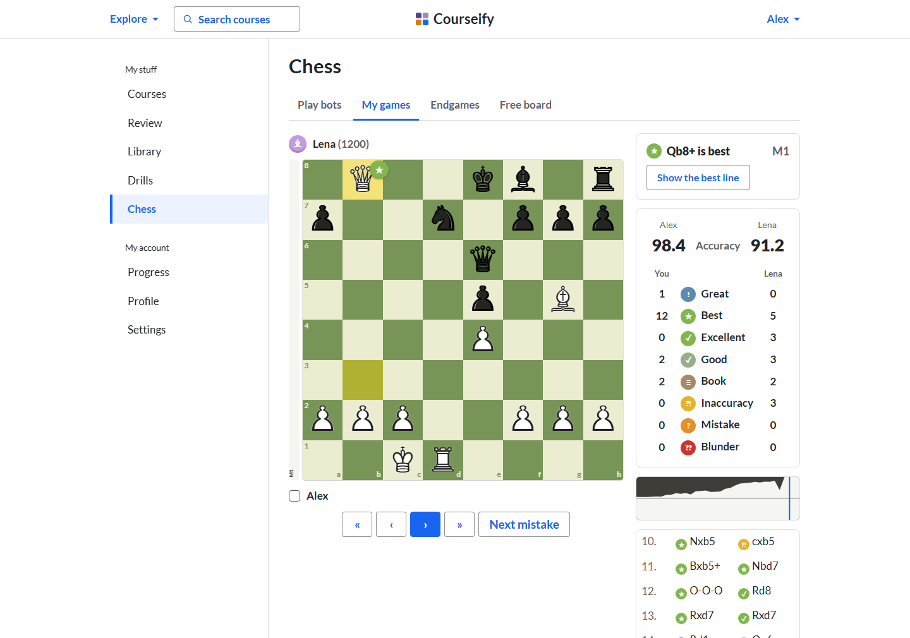<br /><sub><b>Game review.</b> Every move classified, the best move on the board, accuracy for both sides.</sub></td>
    <td width="50%" valign="top">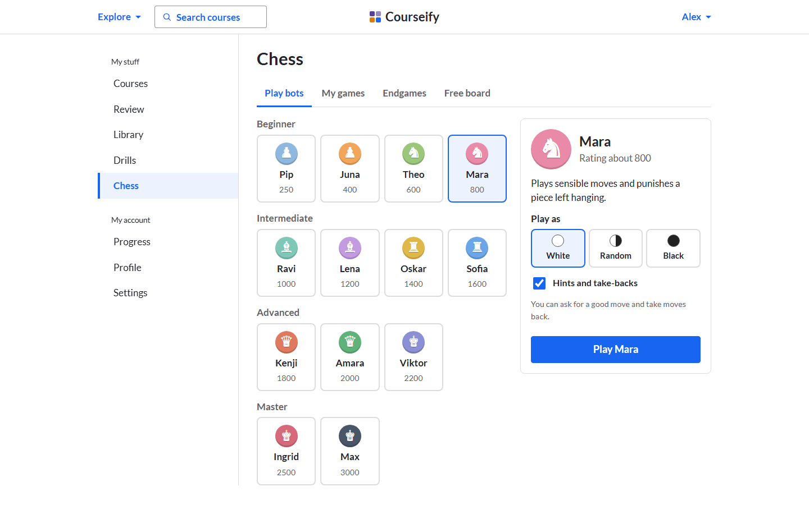<br /><sub><b>29 bots.</b> From a first game to 3200, each with its own style, plus clocks from bullet to rapid.</sub></td>
  </tr>
  <tr>
    <td width="50%" valign="top">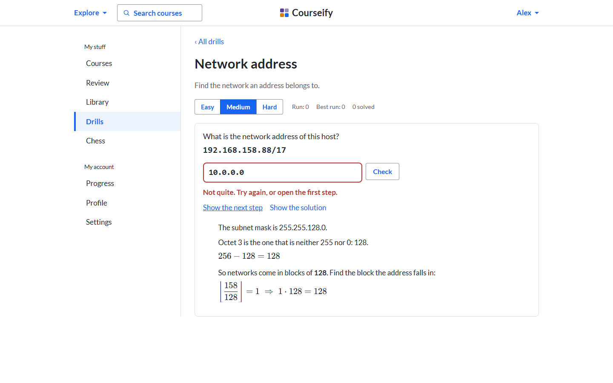<br /><sub><b>Drills.</b> A new problem every time; open the solution one step at a time.</sub></td>
    <td width="50%" valign="top">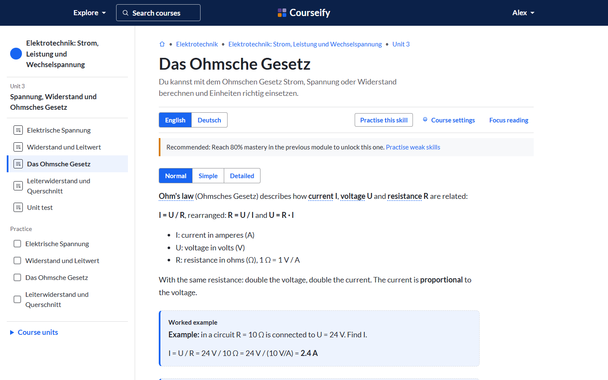<br /><sub><b>Lessons.</b> Three depths, two languages, and terms you can tap.</sub></td>
  </tr>
  <tr>
    <td width="50%" valign="top">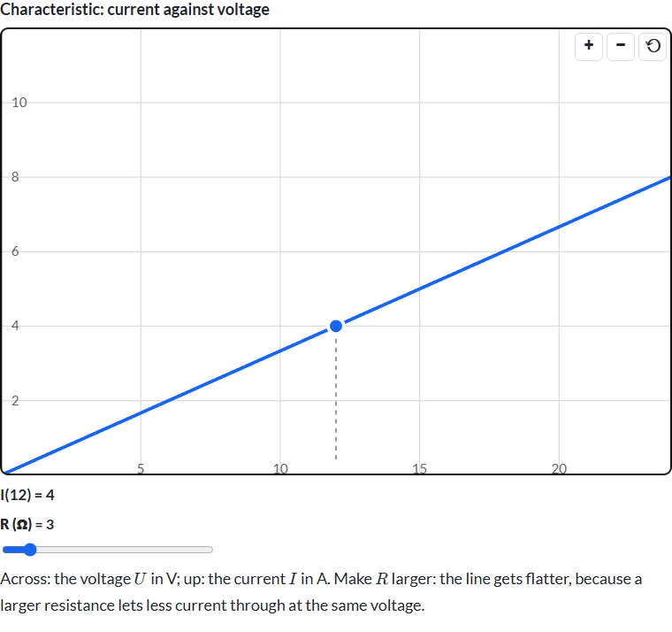<br /><sub><b>Graphs with sliders.</b> Drag across the graph to read off values.</sub></td>
    <td width="50%" valign="top">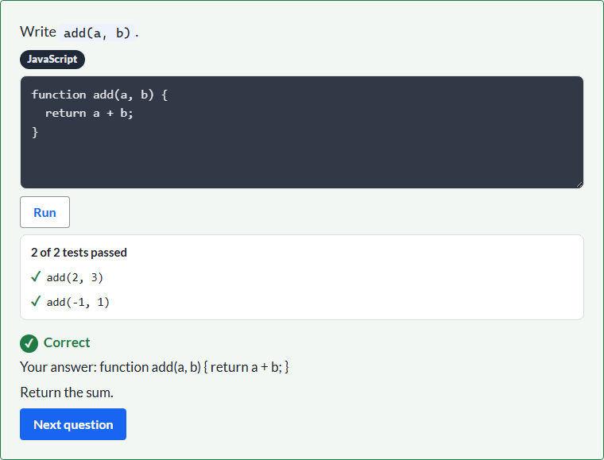<br /><sub><b>Code exercises.</b> Write the function; tests check it on the spot.</sub></td>
  </tr>
  <tr>
    <td width="50%" valign="top"><br /><sub><b>Progress.</b> This week at a glance, then mastery by subject, course and unit.</sub></td>
    <td width="50%" valign="top">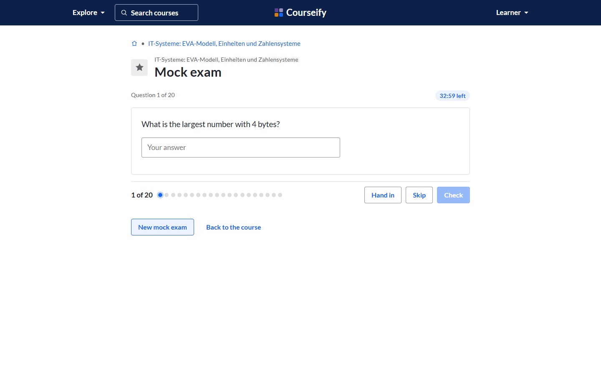<br /><sub><b>Mock exam.</b> Questions from every lesson, timed, graded at the end.</sub></td>
  </tr>
</table>

### On your phone

<div align="center">
<table>
  <tr>
    <td></td>
    <td>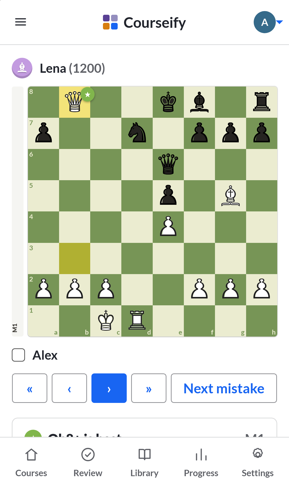</td>
    <td>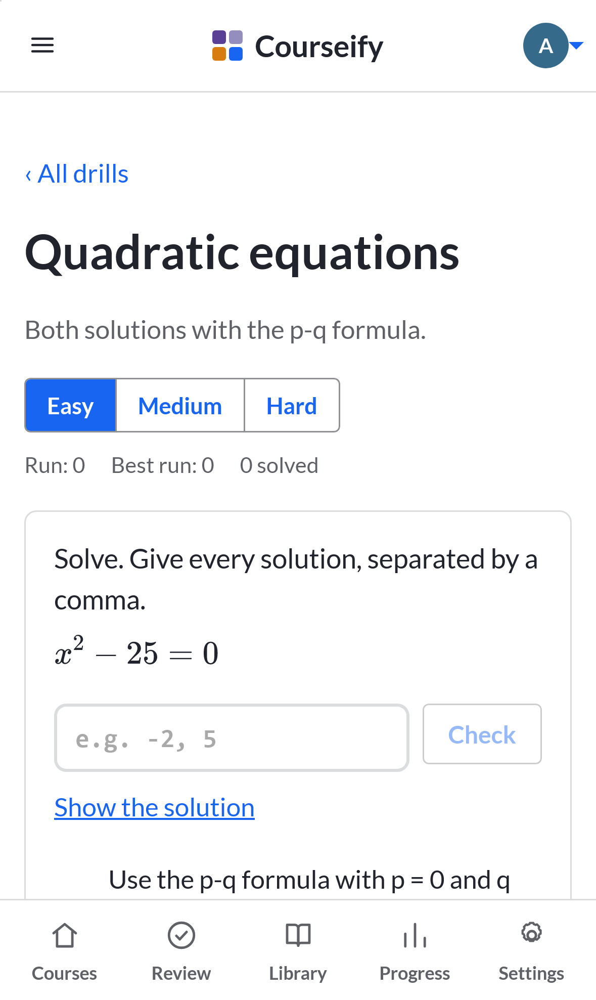</td>
    <td>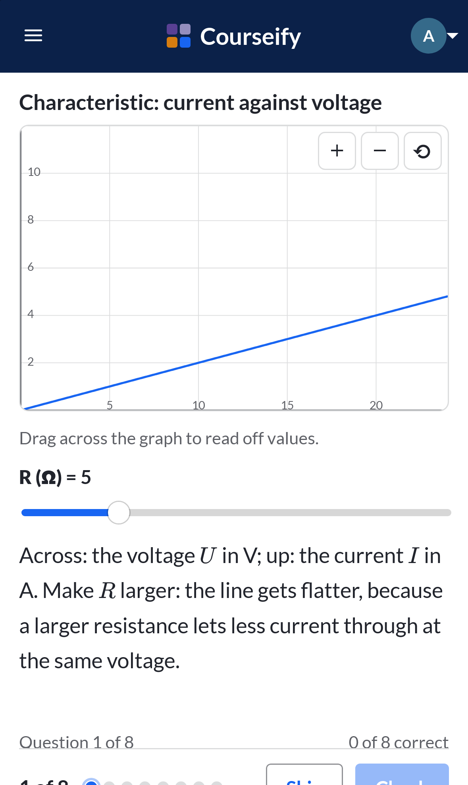</td>
  </tr>
</table>
<sub>Add it to your home screen and it opens like an app, with or without a connection.</sub>
</div>

## Courses included

These come with the app, in your library from the first start, and update by themselves when a new
version is out (your progress stays). Delete one and it stays deleted; add it back any time from
*Ready-made courses*.

| Course | Language | Lessons |
|---|---|---|
| Chess: from improver to 1000 (118 puzzles from real games) | English | 17 |
| IT-Systeme: EVA-Modell, Einheiten und Zahlensysteme | German and English | 19 |
| Datenbanken: ER-Modell, Schlüssel und Tabellen | German and English | 20 |
| Elektrotechnik: Strom, Leistung und Wechselspannung | German and English | 23 |
| Das Pflichtenheft verstehen | German | 11 |
| SQL-Detektiv: Der Fall des Blauen Kristalls | German and English | 7 |
| Programmieren: Pseudocode und Python | German and English | 8 |
| Linux: Die Kommandozeile von Grund auf | German and English | 7 |
| IT-Sicherheit: Schutzziele, Phishing und Passwörter | German and English | 7 |
| Wirtschaft und Rechnen: Prozent, Netzplan, Kosten und Ausbildungsrecht | German and English | 8 |

## How a course is made

1. **Describe it.** Open *Create a course*, pick a starting point and add your notes or handouts.
2. **Get the brief.** Courseify writes a complete brief: an outline first, then one unit at a time, so
   a big course never gets cut off.
3. **Import the reply.** Paste each reply into *Import*. Units land in the right course on their own.
4. **Study.** Read, practise, review. Mastery and progress save as you go.

Prefer to write a course by hand? A course is one JSON file. See
[`examples/sample-course.json`](examples/sample-course.json) and the [course format](#course-format).

## Run it locally

Requires Node 22 or newer.

```bash
git clone https://github.com/M7neeb/courseify.git
cd courseify
npm install
npm run dev        # http://localhost:5173
```

| Command | What it does |
|---|---|
| `npm test` | Unit tests for all app logic |
| `npm run check` | Type checks (svelte-check) |
| `npm run build` | Production build into `dist/` |
| `npm run e2e` | End-to-end tests in Chromium and WebKit (iPhone 15) |

The first end-to-end run needs the browsers: `npx playwright install chromium webkit`.
Every push to `main` is tested, built and published to GitHub Pages.

## Course format

A course is one JSON file: **course → units → lessons → blocks**.

```json
{
  "schemaVersion": 2,
  "id": "linear-functions",
  "title": "Linear Functions",
  "subject": "Math",
  "language": "en",
  "modules": [
    {
      "id": "m1",
      "title": "What is a function?",
      "lessons": [{ "id": "m1-l1", "title": "Inputs and outputs", "blocks": [] }],
      "test": { "id": "m1-test", "type": "module-test", "questions": [] }
    }
  ]
}
```

- **Blocks:** `text` (three depths), `callout`, `example`, `image`, `video`, `flashcards`, `quiz`,
  `code` (runnable), `drill` (generated practice), `graph` (with sliders), `chess`, plus `module-test`
  and `final-exam`.
- **Questions:** multiple choice, true/false, short answer, fill in the blank, numbers, several
  correct, matching, ordering, written, hotspot (tap the picture), code and chess puzzles.
- **Formulas** in LaTeX (`$...$`), **diagrams** as Mermaid code blocks, and an optional **glossary**.
- **Bilingual content** lives in `i18n: { "de": {…}, "en": {…} }` on any block or question.
- **Ids are stable.** Progress and mastery are stored against them, so importing an improved version
  of a course keeps your history.

The full reference is in [`src/prompts/schema.md`](src/prompts/schema.md).

## Built with

- [Svelte 5](https://svelte.dev) and TypeScript, bundled with [Vite](https://vite.dev)
- [idb](https://github.com/jakearchibald/idb) for storage in the browser (IndexedDB)
- [marked](https://marked.js.org) and [DOMPurify](https://github.com/cure53/DOMPurify) for lesson text, [KaTeX](https://katex.org) for formulas, [Mermaid](https://mermaid.js.org) for diagrams
- [ts-fsrs](https://github.com/open-spaced-repetition/ts-fsrs) for spaced review
- [chess.js](https://github.com/jhlywa/chess.js) for chess rules, and [Stockfish 18](https://stockfishchess.org) (the lite WebAssembly build from [stockfish.js](https://github.com/nmrugg/stockfish.js), GPL v3, licence in `public/engine/`) for the bots and game reviews
- [Pyodide](https://pyodide.org) to run Python in the browser, downloaded only the first time you run Python code
- [vite-plugin-pwa](https://vite-pwa-org.netlify.app) for offline use and installation
- [Playwright](https://playwright.dev) for end-to-end tests
- [Lato](https://fonts.google.com/specimen/Lato), bundled so it works offline
- Chess pieces from [Noto Sans Symbols 2](https://github.com/notofonts/symbols) (SIL Open Font License); puzzles from the [Lichess puzzle database](https://database.lichess.org/#puzzles) (CC0)

No backend, no UI framework, no trackers.

```
src/
  core/        app logic: mastery, review, drills, chess review, course builder, storage, import
  features/    one folder per screen: home, unit, player, drills, play (chess), stats, …
  blocks/      one renderer per lesson block type
  ui/          shared components: board, graph, code editor, header menus, mastery squares
  styles/      the look
  i18n/        English and German interface text
courses/       the courses that come with the app
tests/e2e/     end-to-end tests
```

## Roadmap

- [x] Spaced review (FSRS) and mastery that fades without practice
- [x] Courses that come with the app
- [x] Code exercises in lessons, JavaScript and Python
- [x] Chess bots with full game reviews
- [x] Generated drills for IT and maths, graphs with sliders
- [ ] Free sync between devices through your own Google Drive ([plan](docs/plan-drive-sync.md))

## Privacy

Courseify has no server and no analytics. Your courses and progress live in your browser's storage on
your device. Videos load from YouTube's privacy-enhanced domain only when you open a lesson that has
one, and Python is downloaded from this site only when you first run Python code.

## License

[MIT](LICENSE). Use it, change it, share it. The bundled Stockfish engine is GPL v3 (see
`public/engine/STOCKFISH-LICENSE.txt`).
