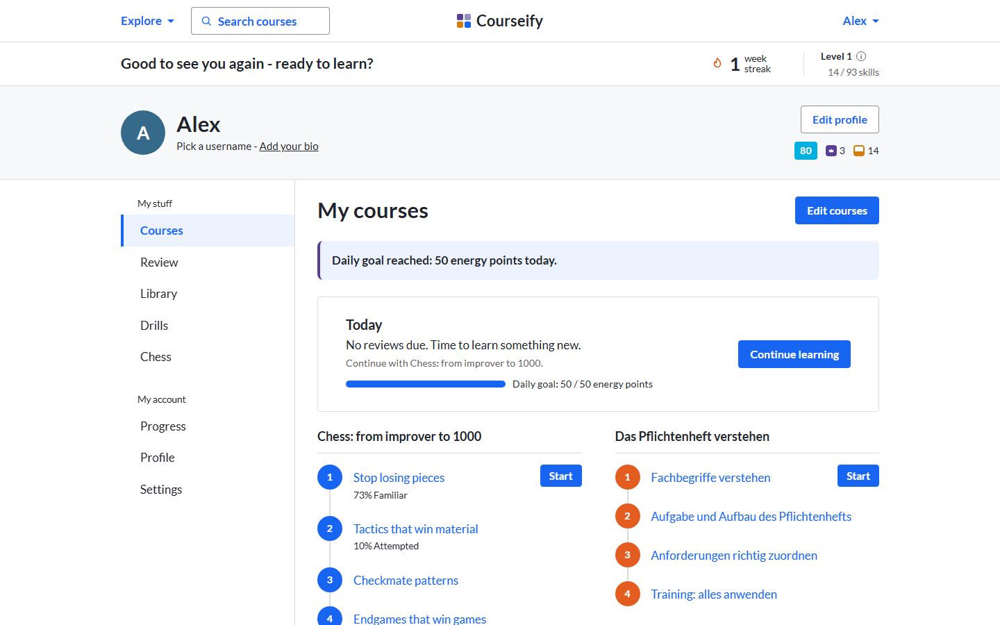
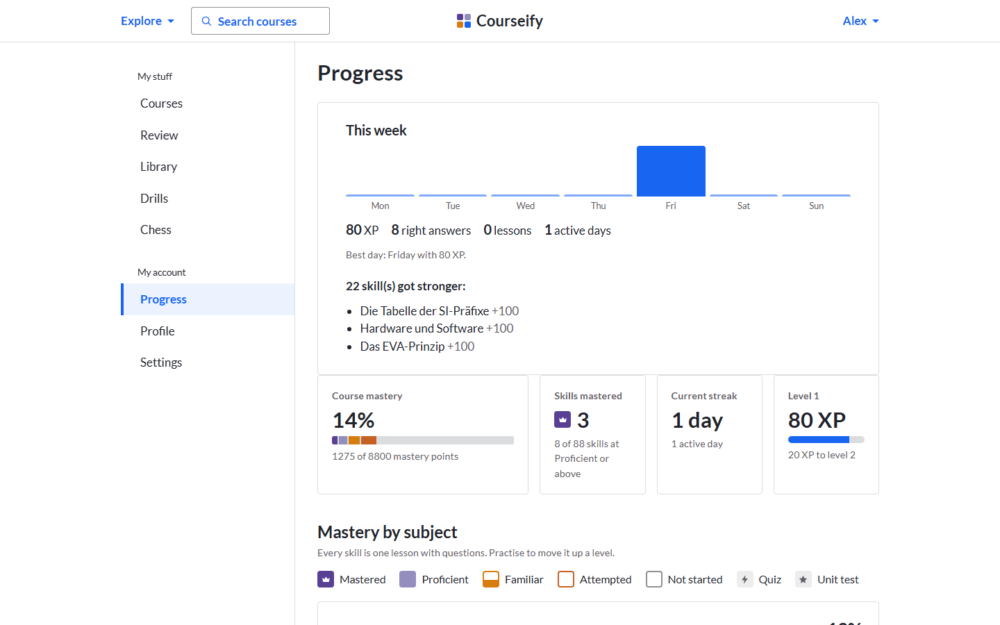
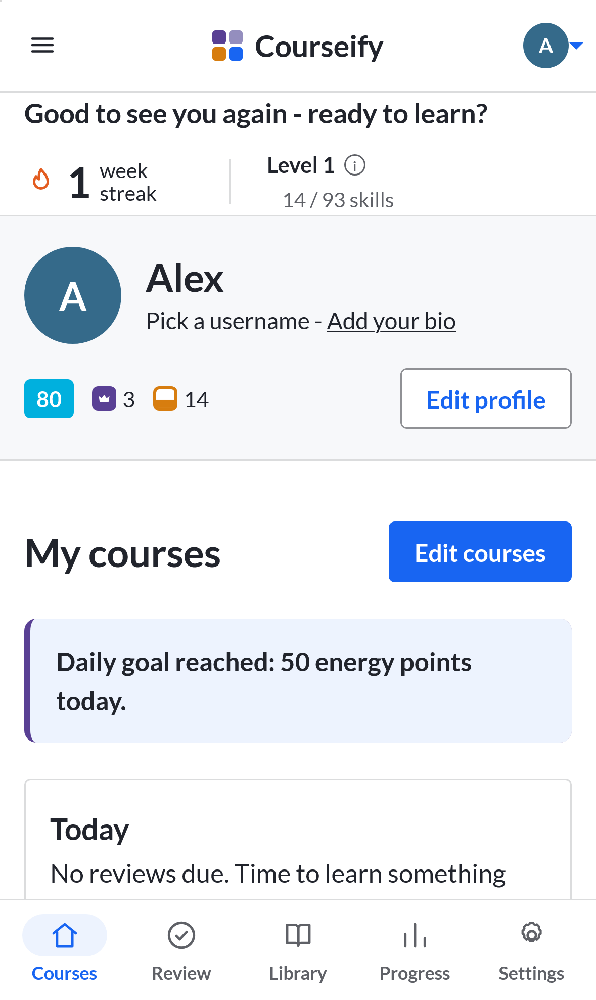

<div align="center">


# Courseify

**Free courses on any topic, built from your own material, with mastery you can see.**

Create a course with any chat AI, import it, and learn it properly: lessons, videos, practice,
mastery tracking and a review of exactly what you got wrong. No account, no subscription, no tracking.

[**Open Courseify**](https://m7neeb.github.io/courseify/) &nbsp;·&nbsp; [Features](#features) &nbsp;·&nbsp; [How it works](#how-it-works) &nbsp;·&nbsp; [Run it locally](#run-it-locally)

[](https://github.com/M7neeb/courseify/actions/workflows/deploy.yml)


[](LICENSE)



</div>

## Why Courseify

Learning apps either cost a subscription, can't be customised, or won't let you study *your* material.
Notes and chat answers are not a course: there's no practice, no feedback and no record of what you
still get wrong.

Courseify turns any topic, or your own handouts and class notes, into a real course: short lessons,
lots of practice, skills that level up from *Attempted* to *Mastered*,
and a review that brings back exactly the questions you missed.

## Features

**Learn**
- **Lessons in three depths.** Every explanation comes as normal, simple (for when you're lost) and
  detailed (precise terms and edge cases), plus worked examples, key points and common-mistake warnings.
- **Videos ready to play.** YouTube videos sit right inside the lesson, ready to play.
- **German and English.** Bilingual courses get a language switch in every lesson. Handy when the exam
  is in German but you think in English.

**Practise**
- **Nine question types:** multiple choice, true/false, short answer, fill in the blank, numbers,
  several correct, matching, ordering and chess puzzles. Each with step-by-step hints and an explanation.
- **Chess on the board.** Worked examples you step through, puzzles you solve by playing the moves,
  endgames you play out against a built-in computer, and a practice board for full games. A
  ready-made course, *Chess: from improver to 1000*, comes with 118 puzzles from real games.
- **Courses included.** *Chess: from improver to 1000*, *Zahlensysteme, Einheiten und Speicher* and
  *Das Pflichtenheft verstehen* are in the library from the first start. A deleted one stays deleted
  and can be added again from Ready-made courses.
- **Practice sets per skill.** Missed questions come first, then ones you have never tried.
- **Mistake review.** Every wrong answer is saved and comes back later, preferring a different variant
  of the same question.

**Track**
- **Mastery levels.** Every skill earns 0–100 points: *Not started → Attempted → Familiar →
  Proficient → Mastered*. Units, courses and subjects roll up from your skills.
- **Progress by subject.** See Math, IT or English at a glance, drill into a course and its units, and
  get a list of the weakest skills to practise next.
- **Unlock in order or study freely.** Lessons can unlock as you reach Familiar, or stay open with a
  recommendation instead.

**Create**
- **Course builder.** Six short steps (goal, your material, languages, structure, practice, extras)
  turn into prompts for any chat AI: an outline first, then one prompt per unit and a final exam, so a
  big course never gets cut off.
- **Built around your material.** Paste or attach your handouts; the course follows them, cites them,
  and marks anything added from general knowledge.
- **Exam mode.** Exam-style questions, German task verbs (*Operatoren*) and requirement levels I–III.
- **Import that forgives.** Courses, single units and final exams import from a file or pasted text,
  even with extra text around the JSON. Anything broken is listed with a ready-made repair prompt.

**Yours**
- **Works offline** and installs on your phone's home screen.
- **Private by design.** Everything stays in your browser. Backups are one click.
- **Ten colour themes** with light and dark modes.

## Screenshots

<table>
  <tr>
    <td width="50%"><br /><sub><b>Unit page.</b> Mastery squares for every skill, lessons with Learn and Practice.</sub></td>
    <td width="50%"><br /><sub><b>Lesson.</b> Explanation depths, key points and a video ready to play.</sub></td>
  </tr>
  <tr>
    <td width="50%"><br /><sub><b>Practice.</b> One skill at a time, with hints and instant feedback.</sub></td>
    <td width="50%"><br /><sub><b>Progress.</b> Mastery by subject, course and unit.</sub></td>
  </tr>
  <tr>
    <td colspan="2"><br /><sub><b>Course builder.</b> Six steps to a prompt that produces a complete, importable course.</sub></td>
  </tr>
</table>

<div align="center">
<table>
  <tr>
    <td></td>
    <td></td>
    <td></td>
  </tr>
</table>
<sub>On a phone: install it to the home screen and it works offline.</sub>
</div>

## How it works

1. **Create.** Open *Create a course*, pick a preset (exam prep, programming, a quick refresher, …),
   paste your notes and answer a few questions.
2. **Generate.** Copy the prompt into ChatGPT, Claude, Gemini or DeepSeek. Start with the outline,
   then ask for one unit at a time.
3. **Import.** Paste each reply into *Import*. Units land in the right course automatically.
4. **Study.** Read, watch, practise. Mastery and progress save as you go.

Prefer to write a course by hand? Every course is a single JSON file. See
[`examples/sample-course.json`](examples/sample-course.json) and the [course format](#course-format).

## Run it locally

Requires Node 22 or newer.

```bash
git clone https://github.com/M7neeb/courseify.git
cd courseify
npm install
npm run dev        # http://localhost:5173
```

| Command | What it does |
|---|---|
| `npm test` | Unit tests for all app logic |
| `npm run check` | Type checks (svelte-check) |
| `npm run build` | Production build into `dist/` |
| `npm run e2e` | End-to-end tests in Chromium and WebKit (iPhone 15) |

The first end-to-end run needs the browsers: `npx playwright install chromium webkit`.

Every push to `main` is tested, built and published to GitHub Pages.

## Course format

A course is one JSON file: **course → units → lessons → blocks**.

```json
{
  "schemaVersion": 2,
  "id": "linear-functions",
  "title": "Linear Functions",
  "subject": "Math",
  "language": "en",
  "modules": [
    {
      "id": "m1",
      "title": "What is a function?",
      "lessons": [{ "id": "m1-l1", "title": "Inputs and outputs", "blocks": [] }],
      "test": { "id": "m1-test", "type": "module-test", "questions": [] }
    }
  ]
}
```

- **Blocks:** `text` (three depths), `callout`, `example`, `image`, `video`, `flashcards`, `quiz`,
  plus `module-test` and `final-exam`.
- **Bilingual content** lives in `i18n: { "de": {…}, "en": {…} }` on any block or question.
- **Ids are stable.** Progress and mastery are stored against them, so importing an improved version
  of a course keeps your history.

The full reference that the course builder gives to the AI is in
[`src/prompts/schema.md`](src/prompts/schema.md).

## Built with

- [Svelte 5](https://svelte.dev) and TypeScript, bundled with [Vite](https://vite.dev)
- [idb](https://github.com/jakearchibald/idb) for storage in the browser (IndexedDB)
- [marked](https://marked.js.org) and [DOMPurify](https://github.com/cure53/DOMPurify) for lesson text
- [vite-plugin-pwa](https://vite-pwa-org.netlify.app) for offline use and installation
- [Playwright](https://playwright.dev) for end-to-end tests
- [Lato](https://fonts.google.com/specimen/Lato), bundled so it works offline
- [chess.js](https://github.com/jhlywa/chess.js) for chess rules; the computer opponent is Courseify's own small engine
- Chess pieces from [Noto Sans Symbols 2](https://github.com/notofonts/symbols) (SIL Open Font License), cut down to the 12 piece glyphs
- Chess puzzles from the [Lichess puzzle database](https://database.lichess.org/#puzzles) (CC0, public domain)

No backend, no UI framework, no trackers.

```
src/
  core/        app logic: mastery, gating, practice, progress, course builder, storage, import
  features/    one folder per screen: home, unit, player, exercise, review, stats, prompt-builder, …
  blocks/      one renderer per lesson block type
  ui/          shared components: header menus, mastery squares, sidebar
  styles/      the look (theme.css)
  i18n/        English and German interface text
tests/e2e/     end-to-end tests
```

## Roadmap

- [x] Smarter review scheduling (FSRS) and mastery that fades without practice
- [ ] Coding exercises inside lessons: JavaScript, Python and SQL, running in the browser
- [x] Ready-made courses (the first one: chess)
- [ ] Free sync between devices through your own Google Drive

## Privacy

Courseify has no server and no analytics. Your courses and progress live in your browser's storage on
your device. Videos load from YouTube's privacy-enhanced domain only when you open a lesson that has one.

## License

[MIT](LICENSE). Use it, change it, share it.
